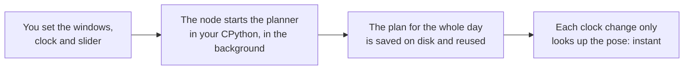

# Active Light Optimizer

**A Grasshopper plugin for Rhino 8 that works out how an active window's shading should move through the day.** At the light setting it keeps direct sun out of the way. Below that, it also weighs thermal comfort in a reference room.

Release 1.0.0 · Windows 10 / 11 · Rhino 8 · MIT licence · Author: Felix Boustead

- 1 to 15 windows per node
- Runs entirely on your PC, with no internet connection
- One node does the planning. Five helper nodes let you describe your own window mechanism.

```text
            ┌──────────────────────────────┐
     run  ──┤                              ├── ring       1.36°
 windows  ──┤                              ├── aperture   100 %
     epw  ──┤                              ├── ids        w01
    days  ──┤                              ├── status     planned …
  slider  ──┤                              ├── a          {json}
   month  ──┤                              │
     day  ──┤    Active Light Optimizer    │
    hour  ──┤                              │
  minute  ──┤                              │
   scene  ──┤                              │
building  ──┤                              │
background──┤                              │
   nproc  ──┤                              │
  config  ──┤                              │
plans_file──┤                              │
   north  ──┤                              │
            └──────────────────────────────┘
```

<sub>Example outputs from the release test: one window, 21 June 10:00, Williamtown weather.</sub>

## Contents

- [What it does](#what-it-does)
- [What you need](#what-you-need)
- [Install](#install)
- [First run](#first-run)
- [Inputs and outputs](#inputs-and-outputs)
- [Reading the status line](#reading-the-status-line)
- [Your own window](#your-own-window)
- [Before you trust a number](#before-you-trust-a-number)
- [Files and privacy](#files-and-privacy)
- [Licence and credits](#licence-and-credits)

## What it does

You give the node one to fifteen windows and a clock time. For each window it returns a **ring angle** in degrees and an **aperture** in percent closed. One slider sets what the plan is for.

| Mode | Setting | What it plans for |
|---|---|---|
| **Light** | `slider = 1` (default) | Plans the window's moves for the day so direct sun stays out of the way. The default plans three days: the day before, the clock day and the day after. This is the fast choice. |
| **Comfort** | `slider < 1` | Also weighs thermal comfort in one reference room. Comfort is counted with the adaptive standard EN 16798-1 (category II) from 07:00 to 23:00. Needs `days = "all"`. At 0 it plans for comfort only. |
| **Your own window** | `scene` input | Describe your own mechanism with five ALO nodes and wire it into `scene`. Without it, the node plans for the built-in window. |

### How a plan is made



Rhino stays usable while the planner runs. A change of window, slider, days, weather or building starts a new plan.

## What you need

- Windows 10 or 11.
- Rhino 8 with Grasshopper.
- CPython 3.9 or newer from [python.org](https://www.python.org/downloads/windows/). No extra packages and no pip.
- An EnergyPlus weather file (`.epw`) of your choice. The tool does not pick one for you. A Williamtown (Newcastle, NSW) file is included as an option.
- About 1 GB of free disk space for caches. The 15-window test used 114 MB.

## Install

1. **Install CPython.** Install CPython 3.9 or newer and note the full path of `python.exe`.

2. **Install the plugin.** In Rhino 8 type `_PackageManager`, search for `ActiveLightOptimizer` and install it. For a local file, download `ActiveLightOptimizer-1.0.0.yak` from this repository's Releases page and drag it into the Rhino window, or run:

   ```bat
   yak install ActiveLightOptimizer-1.0.0.yak
   ```

   Restart Rhino.

3. **Tell it where Python and the weather file are.** Create `%LOCALAPPDATA%\ActiveLightOptimizer\engine_config.json`:

   ```json
   {"python": "C:/some/folder/python.exe", "epw": "C:/some/folder/weather.epw"}
   ```

   Forward slashes work in the paths. The file sits outside the plugin, so an update never overwrites it. You can set the Windows variables `ALO_PYTHON` and `ALO_EPW` instead. If CPython 3.9+ is on your PATH, the `python` entry is not needed.

4. **Open the example.** Open `ActiveLightOptimizer_example.gh` from the package. Or place the node yourself: the tab is *ActiveLightOptimizer* and the node is *Active Light Optimizer*. Connect a Plane (the outward normal of the window) to `windows` and set `run` to True.

5. **Check the install.** The `status` output ends with `| engine: <folder> (from ...)`. Open that folder and double-click `check_install.cmd`. Every line should say PASS. A FAIL line names the setting to fix.

The engine ships inside the plugin as one zip. On first run the node unpacks it once to `%LOCALAPPDATA%\ActiveLightOptimizer\engine`. You do not paste any script.

## First run

1. Open the example. Leave the slider at 1 and `days` at `"dayahead"`.
2. Switch `run` on. The `status` says "planning in background" and counts the seconds. Keep working in Rhino.
3. When it says "planned", the ring and aperture lists fill in. Change the clock and the answer appears at once.
4. Only the first run is slow. On the 4-core test PC, one window took about 75 s day-ahead. Later runs reuse the saved plan.

> [!NOTE]
> The clock inputs (`month`, `day`, `hour`, `minute`) are the local standard time of your weather file, without daylight saving.

## Inputs and outputs

Every input is optional. With nothing connected except `run`, the node plans one default north-facing window.

| Input | Type | What it does |
|---|---|---|
| `run` | bool | True plans again when inputs changed. False keeps the last plans and only looks up poses. |
| `windows` | Plane or JSON, 1–15 | One window per item. A Plane gives the outward window normal. JSON example: `{"id": "W1", "facing": 180, "tilt_deg": 90, "level_m": 1.0}` |
| `epw` | text | Path of the weather file. Wins over the config file and `ALO_EPW`. There is no built-in default. |
| `days` | text | `"dayahead"` (default), `"all"` for the full year, or day numbers such as `"171,354"` (0 = 1 January). |
| `slider` | number 0–1 | 1 = light (default), 0 = comfort. Values between mix the two. |
| `month`, `day`, `hour`, `minute` | integer | The clock in local standard time of the weather file. Default 1 May 10:00. |
| `scene` | ALO Scene, JSON or path | Your own window mechanism. Not set means the built-in window. |
| `building` | JSON or path | Optional doors, vents, heat recovery and fan. Comfort mode only. |
| `background` | bool | True (default) plans in a second process so Rhino stays usable. |
| `nproc` | integer | Planning processes. Ships as 4. Set it to your number of CPU cores. |
| `config` | text | Full path of an `engine_config.json`. Wins over every other source. |
| `plans_file` | text | A plan file made on another computer with the engine's command line. |
| `north` | degrees | Angle from the model's +Y axis to true north, clockwise. 0 means +Y is north. |

| Output | What it gives |
|---|---|
| `ring` | Ring angle for each window, in degrees. |
| `aperture` | Aperture for each window, in percent closed. |
| `ids` | The window names, in the same order. |
| `status` | One line saying what the tool is doing, or an ERROR. |
| `a` | JSON with the release, comfort room, active switches with their limits, and warnings. |

## Reading the status line

The node never turns red. A problem comes back as empty lists and a `status` that starts with ERROR and says what to fix.

**Planning.** The plan is being computed. Wait.

```text
no plans yet: 1 windows (1 classes), planning in background, 42 s elapsed
```

**Ready.** The answer is for minute 246840 of the year (21 June, 10:00). The end of the line says which engine and which window scene were used.

```text
1 windows (1 classes), planned, minute 246840, plan 76 s: w01 r1.36 a100.00 | engine: … (from plugin package) | scene: base
```

**Error.** Something must be fixed. [USER_GUIDE.md](USER_GUIDE.md) section 10 lists every message with its fix.

```text
ERROR: no weather file set: set "epw" in engine_config.json, or the ALO_EPW environment variable, or the epw input …
```

**Warning.** You switched on an optional building feature. Read its limits before using the numbers.

```text
WARNING opt-in with known limits active: …
```

## Your own window

The built-in window is the default. To plan for your own mechanism, describe it with five nodes from the Active Light Optimizer category and wire the result into the `scene` input. These nodes only describe the window. The main node does the planning.

| Node | What it describes |
|---|---|
| **ALO Parameter** | One movement parameter: name, minimum, maximum, steps. Release 1.0 needs exactly two: the steering rotation first (0 to 15°), then the opening drive (0 to 100 %). |
| **ALO Joint** | A hinge: name, the parameter that drives it, the hinge axis as a line, and a gain in signed degrees per unit. Check the sign in the pose preview. |
| **ALO Body** | A rigid part: name, role (*mouth* is a clear opening, *blocker* is a plate that shades), geometry, and its chain of joints from the root. |
| **ALO Room Target** | A room face the beam may land on. |
| **ALO Scene** | Collects everything with the units, north angle and exterior direction. Returns the scene, a status and a pose preview at minimum, middle, maximum and one pose you choose. |

In 1.0 a custom window can have two movement parameters and hinged joints only. Blocker parts must be long and thin, with a length at least 3 times the width. Casement, awning, pivot and louvre types and sliding joints are planned for a later release.

## Before you trust a number

> [!IMPORTANT]
> Most test cases were also used to build the tool. Read [LIMITS.md](LIMITS.md) before you use a number.

- Comfort is scored for one reference room, from 07:00 to 23:00. Use it to compare designs. It does not predict your own room.
- Absolute room temperatures were about 1.3 to 1.4 K off on held-out data. Use them to rank designs and relative changes.
- Comfort mode improves the cold side. Gains on the warm side are not demonstrated.
- Beams are planned with a clear-sky geometric model. Beam accuracy was checked against an independent ray cast for the built-in window only. Custom windows are not independently checked in 1.0.
- When the sun is above about 60° for a window's facing, that day's light plan is empty. This is a limit of the mechanism, not a weather file error.

**First-run times** on an idle 4-core test PC, cold cache, `nproc` 4, light slider. Other PCs differ.

| Case | Time |
|---|---:|
| 1 window, day-ahead | 74.5 s |
| 3 windows, day-ahead | 162.9 s |
| 1 window, 12 days | 88.6 s |
| 15 windows, 12 days | about 20 min |

## Files and privacy

- Nothing leaves your machine. The tool opens no network connection.
- The engine, caches and logs live in `%LOCALAPPDATA%\ActiveLightOptimizer`. The cache folders `plans`, `scen`, `gh_bg` and `logs` are safe to delete. The tool plans again.
- To uninstall, open `_PackageManager`, go to Installed, choose ActiveLightOptimizer, click Uninstall and restart Rhino. Delete the folder above by hand if you want.
- The optional Williamtown TMYx 2011–2025 weather file is used only if you point `epw` at it.

## More documentation

- [USER_GUIDE.md](USER_GUIDE.md): all inputs, switches, settings, the building recipe and troubleshooting by message.
- [LIMITS.md](LIMITS.md): what the tool does not do and how far to trust it.

## Licence and credits

Active Light Optimizer is released under the MIT licence. See [LICENSE](LICENSE).

Copyright Felix Boustead.

Third-party credits are in [THIRD_PARTY_NOTICES.md](THIRD_PARTY_NOTICES.md). They cover EnergyPlus, the weather data from Climate.OneBuilding.Org and the methods the tool uses.
